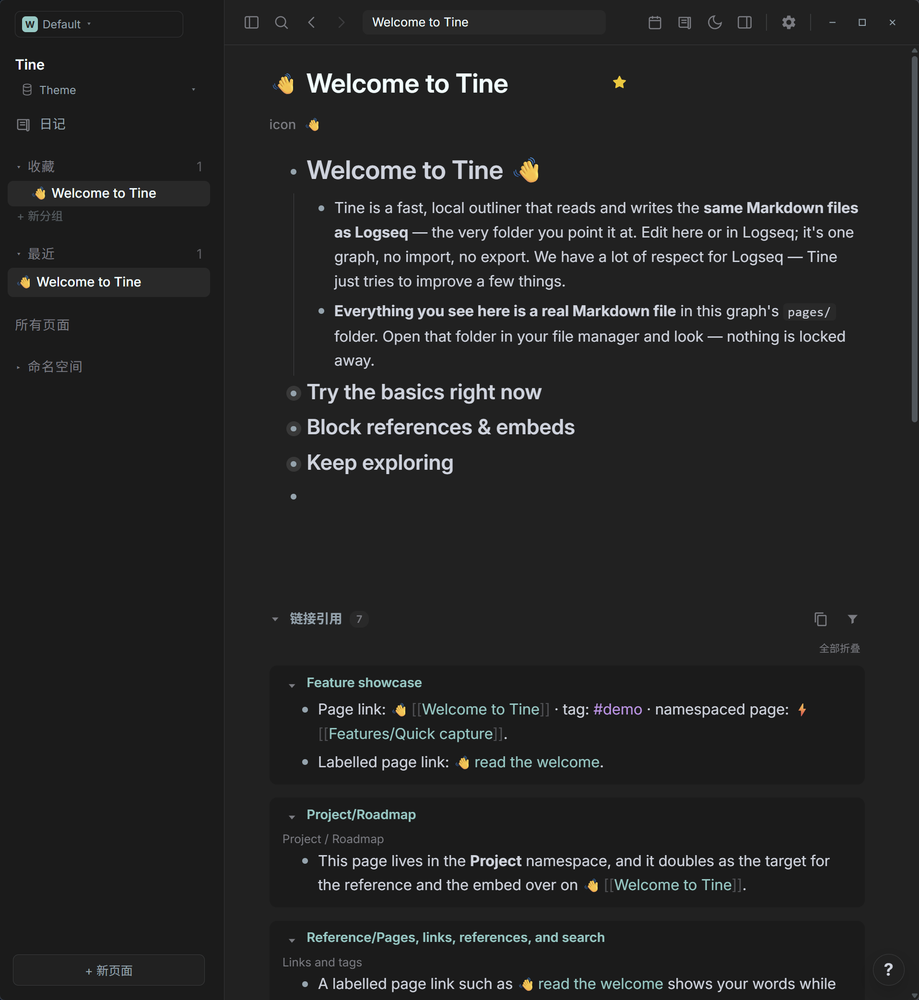
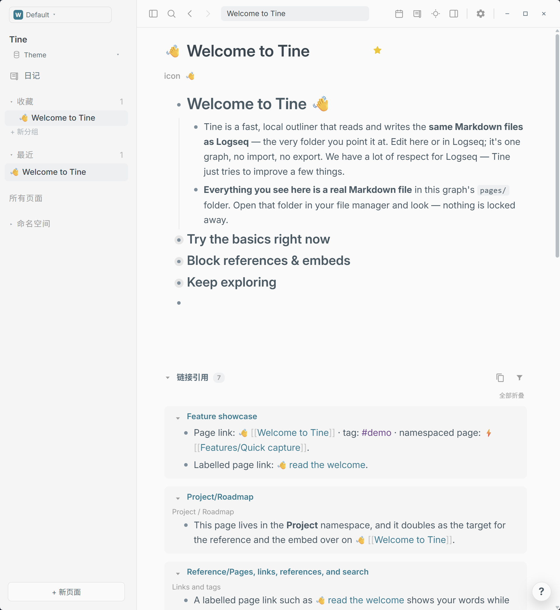

# Material · Prism

**青色细线穿过静静的石面，清晨在银白里展开。让每段思绪，都落在清晰之处。**

[English](README.md) · [下载 theme.json](https://github.com/EllisMorrow/tine-theme-material-prism/releases/latest/download/theme.json)

Material Night Eighties 与 Material Night 相映于一套主题：夜里是经典的深炭灰色，白日则回到柔和明亮的浅色，并以青绿与紫色点染。

### 深色模式

### 浅色模式

*用户测试后提供的 Windows 实机截图，两套配色均实际包含在同一个主题包中。*

## 安装

1. 下载 [theme.json](https://github.com/EllisMorrow/tine-theme-material-prism/releases/latest/download/theme.json)。
2. 在 Tine 打开 **设置 → 外观 → 主题包 → 选择 theme.json**，选择下载的文件。
3. 点击 **使用颜色**，选择 **浅色、深色或跟随系统**。

需要主题 API **0.2** 支持。原有 `logseq/custom.css` 和设备强调色可能影响效果；主题只负责 API 支持的颜色，不包含额外字体、布局或任务标记样式。

## 配色

| 角色 | 浅色 | 深色 |
| --- | --- | --- |
| 主背景 | `#FAFAFA` | `#212121` |
| 侧栏 | `#F5F5F5` | `#1b1b1b` |
| 正文 | `#455A64` | `#CDD3DE` |
| 标题 | `#37474F` | `#EEFFFF` |
| 强调色 | `#39ADB5` | `#80CBC4` |
| 链接 | `#007C91` | `#80CBC4` |
| 标签 | `#75458F` | `#C792EA` |
| 高亮底色 | `#FFF1C2` | `#4A3C2E` |

## 验证情况

通过官方主题格式检查；浏览器样例检查了两套完整变量、模式切换及指定颜色组合。用户提供了上方 Windows 明暗实机截图，展示公开欢迎页面上的标题、正文、层级、链接、标签、行内代码和引用区域。高亮、选中操作、设置状态和其它平台未由这些截图覆盖，不据此宣称全部路径均已验证。

## 来源与边界

基于 [Material Night Eighties / Material Night](https://github.com/microsoft/vscode-themes)，固定版本 `2a810696b25f1b681138e9c8129e03f463413a85`，采用 MIT 许可；详见 [许可说明](LICENSE)。深色模式参考微软归档套件中的 Material Night Eighties（Material Theme Darker）；该套件基于 equinusocio/material-theme。浅色模式使用同一套件原生的 Material Night 浅色主题。本包为社区 Tine 适配，不含 Codex 代码或资源。

独立社区适配由 EllisMorrow 完成，使用 AI 辅助开发。不分发 Codex 程序代码、标志或附带资源，不代表相关项目或 OpenAI 的官方产品，也不承诺与 Codex 像素级一致。具体映射和验证边界见 [适配说明](docs/adaptation.md)。

顶部徽标统计 GitHub Release 附件累计下载量，不代表安装人数。可在本仓库反馈问题，附版本、系统、模式及不包含私人内容的截图。
